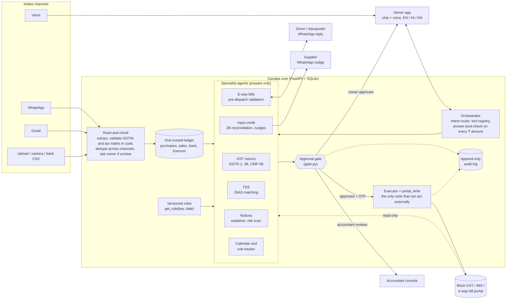
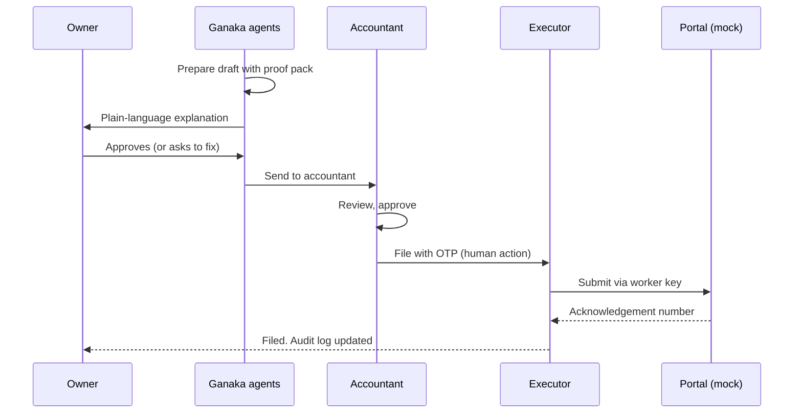

# Ganaka — Simplifying Compliance. Empowering Businesses.

An agentic AI compliance assistant for India's micro businesses (working prototype). It gathers bills from WhatsApp, Gmail and uploads into one ledger, then prepares GST returns, input credit reconciliation, e-way bills, TDS, notice explanations and a compliance calendar, in the owner's language. **Ganaka does the work. The owner stays in control of every decision.**

## Research and references
- [Madras School of Economics, Working Paper 229](https://mse.ac.in/wp-content/uploads/2022/10/Working-Paper-229.pdf): estimates of GST compliance costs for small businesses.
- [CGST Act, Section 129 (CBIC)](https://taxinformation.cbic.gov.in/content/html/tax_repository/gst/acts/2017_CGST_act/active/chapter19/section129_v1.00.html): detention, seizure and release of goods and conveyances (the e-way bill penalty basis).
- [IIM Indore working paper WP-01-2021-22-ECO](https://iimidr.ac.in/wp-content/uploads/2022/06/WP-01-2021-22-ECO.pdf): impact of GST on small businesses.
- [Taxscan: Economic Survey on rising GST compliance cost for MSMEs](https://www.taxscan.in/top-stories/gst-stability-comes-at-rising-compliance-cost-for-msmes-survey-data-suggests-says-economic-survey-1442460)
- [Deloitte India GST@9 survey of MSMEs](https://www.deloitte.com/in/en/about/press-room/msmes-back-gst-reforms-call-for-faster-refunds-and-better-working-capital-support-deloitte-India-gst-9-survey.html)

## The problem
Micro business owners spend 15–20 hours a month on GST, TDS and e-way bill paperwork, pay ₹1,500–3,000 per filing, and can lose 8–12% of annual profit to compliance. Mistakes cost late fees, lost input credit, and goods detained at checkpoints (a penalty of up to 200% of the tax). Figures are from the project brief; see the references above.

## Architecture



### How an action flows (the approval gate)



**Design rules**
- **The agent never files.** Agent modules cannot import `executor.py` or `portal_write.py`, and there is no filing tool in the registry. Tests enforce this.
- **Maths in code.** Calculators are deterministic; the LLM is a stub in this prototype. A post-check verifies every ₹ amount in a chat answer against tool output.
- **Rules are data.** Tax rules are versioned and looked up by date, so they can be updated and audited.
- **Money is integer paise.** Tenancy is by `business_id`, checked in the API layer.
- **Audit log is append-only**, enforced by SQLite triggers.

## What it does
| Area | Capability |
|---|---|
| Intake | Bills via upload, WhatsApp or Gmail; validation in code; cross-channel dedupe; asks the owner when a field is unclear |
| GST returns | GSTR-1, GSTR-3B and CMP-08 drafts with proof pack, set-off per s.49 / r.88A, QRMP quarterly periods |
| Input credit | Three-way reconciliation (books, GSTR-2B, IMS), supplier scores, WhatsApp nudges, IMS action recommendations |
| E-way bills | Pre-dispatch validator (HSN, value, PIN-based distance, vehicle), vehicle number from the transporter by WhatsApp |
| TDS | Obligation flags and 26AS matching |
| Notices | Plain-language explainer and risk scan |
| Calendar and rules | Due dates, payroll, 43B(h), 44AD; rule tracker proposes changes for accountant approval |
| Languages | English, Hindi, Kannada; text and voice; fixed vetted templates |
| Accountant console | Clients, approval queue, calendar, rule updates, capacity |

## Run
```
pip install -r requirements.txt
python -m app.seed --reset        # synthetic data (also auto-seeds on first start)
python -m uvicorn app.main:app --port 8000
python -m pytest -q tests         # 25 tests
```
- Owner app (mobile-first, chat + voice): http://localhost:8000/
- Accountant console: http://localhost:8000/accountant  (priya@demo.in / demo123, OTP 123456)
- WhatsApp + mock-portal simulator (second phones, demo controls): http://localhost:8000/sim
- Mock GST/IMS/e-way bill portal: http://localhost:8000/portal/docs
- Demo owners: Ramesh 9845012345 (Kannada), Lakshmi 9845098765 (QRMP, Hindi), Suresh 9845077777 (services). OTP is always 123456.
- Demo clock is fixed to 2026-11-19 (`MUNSHI_TODAY` to override).

## Demo script
1. `/sim` → "Send as Ramesh" the demo bills (clear, blurry → answer in Inbox, kachha, notice, bank CSV, licence). The Gmail copy of the Gupta bill is linked as a duplicate (Inbox → Sync Gmail).
2. Owner app → Chat: "ee month GST eshtu?" → GSTR-3B draft, proof pack, "₹18,000 stuck with Ravi Traders".
3. Suppliers: approve recommended IMS actions; nudge Ravi (message appears in the sim). In `/sim` make Ravi file → Refresh → credit recovered.
4. E-way bills: ₹72,000 inter-state sale is blocked (HSN mismatch) → refresh Part A; in `/sim` reply as Manju Transport "ka 05 ab 1234" → approve & generate; document pack goes to driver and buyer.
5. Returns → Send to accountant → console queue → approve → File (simulated) with OTP → ack number. Capacity tab.
6. `/sim` → publish the 14-digit advisory → console → Rule updates → scan → approve → owners notified.

## Where things are
| Path | Purpose |
|---|---|
| `app/ingest.py` | Intake, validation, dedupe, clarification |
| `app/calc.py`, `app/rules.py` | Deterministic maths; versioned rules |
| `app/returns.py`, `itc.py`, `eway.py`, `tds.py`, `notices.py`, `calendar_.py`, `tracker.py` | Specialist agents |
| `app/tools.py`, `app/orchestrator.py` | Agent tool registry and chat router |
| `app/gate.py` | Approval gate |
| `app/executor.py`, `app/portal_write.py` | Only code that can act externally |
| `app/portal.py`, `portal_read.py` | Mock portal and its read-only client |
| `app/channels.py`, `gmail.py`, `sarvam.py` | WhatsApp, Gmail and speech adapters |
| `app/static/` | Owner app, accountant console, simulator |
| `deck/` | Pitch deck (`Ganaka_Pitch.pptx`) and its build scripts |
| `tests/` | 25 automated tests |

## Prototype choices and limits
- **LLM is a deterministic stub** (bill text-template extraction, keyword intents). Swap `ingest.extract_text` and `orchestrator.handle` for a vision LLM behind the same schemas. Photos currently ask the owner to key in details.
- **SQLite instead of Postgres with RLS** (tenant checks in the API layer); no Redis, Celery or LangGraph; vanilla-JS UI instead of Next.js.
- **Integrations are optional.** Twilio sends if `TWILIO_*` env vars are set (webhook `/api/whatsapp/webhook`), otherwise WhatsApp is simulated. Gmail reads `demo/mailbox`. Sarvam STT/TTS is used if `SARVAM_API_KEY` is set, otherwise browser Web Speech.
- **Tax rules are assumptions** marked VERIFY in `rules.py`; have an accountant check them before any real use.
- **Baselines are placeholders** (6 h per client, hours-saved factors) until field interviews give real numbers.
- Internal identifiers such as the `MUNSHI_*` environment variables and `munshi.db` keep their original names.
